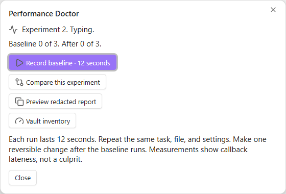
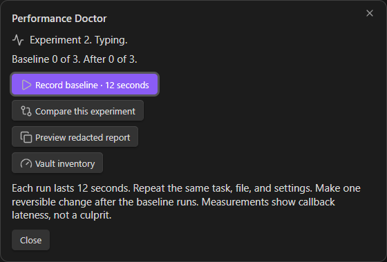
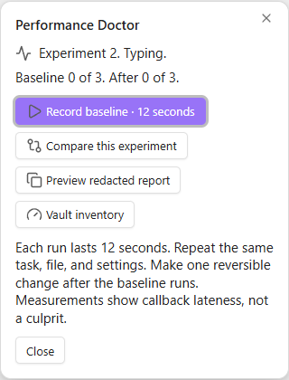
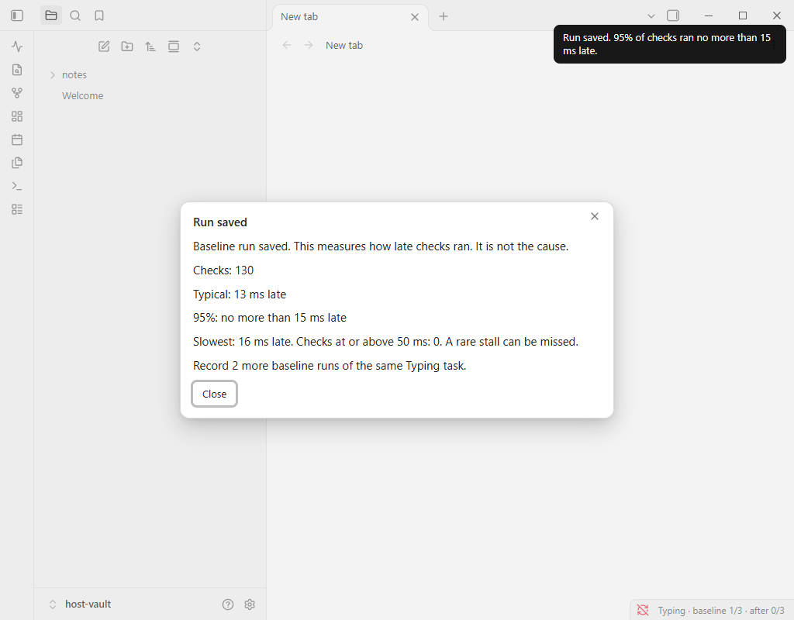

# Performance Doctor

Experimental prerelease 0.1.0. It measures how late a short foreground check ran, then compares a repeated task before and after one change you can undo.

The number is scheduling delay. It is not the cause of a slow vault, not CPU time, and not a startup measurement. Obsidian's own startup timer covers launch time. Divide and Conquer covers turning groups of plugins off. This plugin does neither, and it does not toggle plugins or edit notes.

It was run on Obsidian 1.14.5 on Windows. It is not a finished production release, and it has not been verified on mobile or on other operating systems. `minAppVersion` is 1.14.5 for that reason.

Repository: [christianloooo/obsidian-performance-doctor](https://github.com/christianloooo/obsidian-performance-doctor).

Why this exists, and what it refuses to claim, is in [docs/approach.md](docs/approach.md). What was actually run is in [docs/verification.md](docs/verification.md).

## Install a release

Download the [0.1.0 release zip](https://github.com/christianloooo/obsidian-performance-doctor/releases/download/0.1.0/performance-doctor-0.1.0.zip). It contains only `main.js`, `manifest.json`, and `styles.css`. Copy those three files into `.obsidian/plugins/performance-doctor/` in a vault you can afford to experiment on, then turn the plugin on in Settings → Community plugins.

The built files are release assets. They are not stored in git.

## Use

Open **Performance Doctor** from the ribbon or run **Open experiment guide**. The dialog shows the task, how many baseline and after runs are saved, and one main action:

- **Record baseline · 12 seconds** until three baseline runs exist
- **Record after change · 12 seconds** after you make one reversible change
- **Compare this experiment** once both sides have three runs

The dialog closes before a recording starts. Repeat the same task, the same file, and the same settings for every run. Compare, preview, and inventory are the other actions. Inventory counts files and extension buckets. It does not read note text, and it does not run during a recording.

A saved run says **Run saved** and lists checks, a typical delay, and the 95% delay in plain language. **Preview redacted report** is the only place that shows JSON. A comparison that does not clear the minimum gap says **No clear change measured.**

The repeated task is a closed choice: Typing, Scrolling, Opening notes, or Other repeated task. Change it from Settings only before the experiment has saved runs.

## Privacy

There is no network request and no telemetry. A saved trial stores the condition, interval, duration, sample count, delay summary, a platform name, and the app and plugin versions. The redacted report leaves out vault name, paths, plugin lists, and typed text. See [docs/privacy.md](docs/privacy.md).

## Screenshots

Taken in an isolated disposable vault on Obsidian 1.14.5, not in a personal vault. The dialog shots are the modal only, after notices were gone. The saved-run shot is from the earlier full recording cycle.









Full-window copies of the same dialog are `docs/screenshots/front-light.png`, `front-dark.png`, and `front-narrow.png`.

## Develop

```powershell
npm ci
npm run typecheck
npm test
npm run build
```

`typecheck` is `tsc --noEmit`, not a linter. `npm test` rebuilds the shared core and runs the Node checks, including a failed-save rollback. `npm run build` typechecks again and writes `main.js`. Copy `main.js`, `manifest.json`, and `styles.css` into the plugin folder.

`npm run test:browser` runs the synthetic timing harness in a local browser. Do not treat those numbers as a vault diagnosis.

## License

MIT. See [LICENSE](LICENSE).
